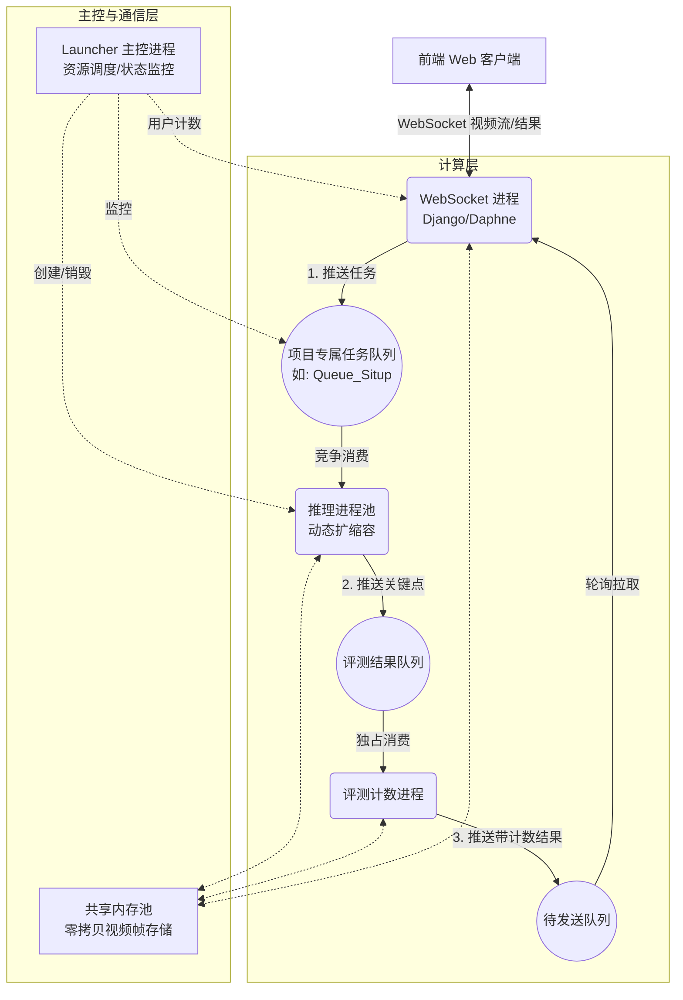

# 体测自动化系统后端架构设计文档（V2.0）

## 1. 项目概述

### 1.1 背景
开发一套自动化体育测试系统。前端网页录制用户动作视频，传输至后端进行实时人体关键点识别、动作计数与作弊检测，并将可视化结果实时推送至前端。

### 1.2 核心目标
- **实时性**：全链路延迟（前端上传 -> 推理 -> 前端显示）控制在 **50ms 以内**（其中推理耗时约 15~30ms）。
- **多项目支持**：支持仰卧起坐、引体向上、坐位体前屈、立定跳远等多种体测项目，不同项目加载不同的深度学习模型。
- **高并发**：支持校内多用户（如一个班级40人）同时在线评测。
- **跨平台**：开发与部署环境需同时兼容 **Windows**（开发/演示）和 **Linux**（生产服务器）。

---

## 2. 系统架构总体设计

### 2.1 架构模式
采用 **“轻量级主控（Launcher） + 动态弹性进程池 + 共享内存通信”** 的单机多进程微服务架构。

### 2.2 进程拓扑图
系统共包含 4 类进程，由主控进程统一管理：



---

## 3. 核心功能模块职责

### 3.1 Launcher 主控进程
- **角色**：系统的大脑（轻量级，不加载任何重型库如 TensorFlow）。
- **职责**：
  1. **资源预分配**：启动时创建**共享内存池**和**跨进程队列**。
  2. **动态伸缩调度**：监听各项目的在线用户数，按策略创建或销毁推理子进程。
  3. **生命周期管理**：接收子进程自杀信号，清理进程列表。

### 3.2 WebSocket 进程（Django + Daphne）
- **角色**：系统的网络出入口。
- **职责**：
  1. 接收前端 WebSocket 视频流（二进制帧）。
  2. 向 Launcher 发送 **用户注册/注销** 命令（增减项目计数器）。
  3. 从共享内存池申请空白块，写入解码后的视频帧。
  4. 将 `(共享内存块名, 用户ID, 项目类型)` 推入对应的项目任务队列。
  5. 轮询“待发送队列”，取出结果帧和计数数据，推送前端。

### 3.3 推理进程池（Inference Workers）
- **角色**：CPU/GPU 密集型计算单元。
- **特性**：
  - **进程与项目绑定**：每个进程启动时只加载**一个固定体测项目**的模型。
  - **动态伸缩**：由 Launcher 按需创建，空闲超时后**自行销毁**。
- **职责**：
  1. 阻塞监听所属项目的任务队列。
  2. 根据共享内存名读取视频帧。
  3. 执行神经网络推理，获取人体关键点坐标。
  4. 将关键点绘制在共享内存帧上。
  5. 将 `(内存块名, 用户ID, 关键点数据)` 推入评测结果队列。

### 3.4 评测计数进程（Evaluation Worker）
- **角色**：单例进程（全局唯一）。
- **职责**：
  1. 消费“评测结果队列”，获取所有项目的推理结果。
  2. 根据 `user_id` 维护用户状态（动作计数、历史姿态）。
  3. 执行动作计数与作弊检测逻辑。
  4. 将计数结果绘制在共享内存帧上。
  5. 将 `(内存块名, 用户ID, 计数结果)` 推入“待发送队列”回传 WebSocket。

---

## 4. 进程间通信（IPC）与数据传输

### 4.1 零拷贝视频帧传输（SharedMemory）
- **机制**：利用 Python `multiprocessing.shared_memory`。
- **策略**：启动时预分配 N 个固定大小的共享内存块（如 30 块，每块约 1MB）。
- **数据流**：WebSocket 写入 -> 推理进程读取并绘制 -> 评测进程读取并叠加文本 -> WebSocket 读取并发送 -> **归还内存池**。
- **优势**：进程间传输视频帧的延迟从 **~15ms（网络/序列化）** 降低至 **< 0.1ms（仅传递内存块名称字符串）**。

### 4.2 控制与元数据传输（multiprocessing.Queue / Manager）
- **用途**：传输任务指令、关键点坐标（JSON）、计数结果等小数据（< 1KB）。
- **队列清单**：
  1. `task_queue_{project}`：项目专属任务队列（多消费者竞争）。
  2. `result_queue`：推理结果汇聚队列（单消费者）。
  3. `send_queue`：待发送给前端的队列（单生产者，单消费者）。
  4. `cmd_queue`：WebSocket 向 Launcher 发送扩容/缩容指令的队列。

---

## 5. 动态弹性伸缩策略（核心算法）

### 5.1 扩容策略（Scale-Up）
- **触发**：Launcher 定时扫描（如每 5 秒）各项目当前在线用户数。
- **目标进程数公式**：
  $$
  Target = \min(MaxCap, \lceil \frac{CurrentUsers}{UsersPerProcess} \rceil)
  $$
  其中 `UsersPerProcess = 2`（根据单路推理 15~30ms 测算，单进程处理 2 路视频依然满足实时性）。
- **动作**：若 `当前进程数 < Target`，Launcher 创建新的推理子进程（传入项目类型）。

### 5.2 缩容策略（Scale-Down）
- **自毁机制**：推理子进程内部循环调用 `queue.get(timeout=IdleTimeout)`。
- **动作**：若超过 `IdleTimeout`（如 60 秒）未取到任务，进程判定自身空闲，主动 `sys.exit(0)` 自杀。
- **善后**：Launcher 定时扫描进程列表，清理已退出的进程 PID，并减少项目进程计数器。

### 5.3 防颠簸措施
- **预热**：利用前端点击“开始准备”到“倒计时 3 秒”的空隙，提前触发 Launcher 创建进程和加载模型。
- **物理隔离**：每个进程只绑定一个项目，彻底杜绝单进程内模型反复切换导致的卡顿。

---

## 6. 数据流转完整时序图

```text
[前端] -> (WebSocket连接) -> [WebSocket进程]
   |
   | 1. 用户点击"开始准备"，发送项目类型
   v
[WebSocket进程] -> (cmd_queue) -> [Launcher]
   |                               | 2. 更新用户数量，检查进程数
   |                               | 3. 若不足，创建推理进程(加载模型)
   | 4. 倒计时结束，发送视频帧      |
   v                               v
[WebSocket进程] -> 申请共享内存块 -> [共享内存池]
   | 5. 写入帧，推送任务            |
   v                               |
[项目专属任务队列]                  |
   | 6. 竞争消费                    |
   v                               |
[推理进程] -> 7. 读取共享内存帧     |
   | 8. 推理，绘制骨骼点            |
   | 9. 推送(内存名+关键点)         |
   v                               |
[评测结果队列]                      |
   | 10. 消费                       |
   v                               |
[评测进程] -> 11. 读取共享内存帧    |
   | 12. 计数，叠加文本             |
   | 13. 推送(内存名+计数结果)      |
   v                               |
[待发送队列]                        |
   | 14. 轮询消费                   |
   v                               |
[WebSocket进程] -> 15. 读取共享内存帧 -> 16. 归还内存块
   | 17. 编码后推送 WebSocket        |
   v                               |
[前端] 显示可视化视频与计数数据
```

---

## 7. 跨平台与部署约束

### 7.1 Windows/Linux 兼容性
- **启动方式**：全局强制使用 `multiprocessing.set_start_method('spawn')`，避免 `fork` 在 Windows 上不可用及 Linux 下的锁继承问题。
- **路径处理**：统一使用 `pathlib.Path`。
- **共享内存回收**：Windows 不会自动回收无主共享内存。主控进程退出时必须显式调用 `shm.unlink()`，并捕获 `FileNotFoundError` 防止残留。

### 7.2 启动方式
- 系统由 `launcher.py` 作为唯一入口启动。
- Launcher 内部使用 `subprocess` 启动 Django/Daphne 进程，使用 `multiprocessing` 启动推理与评测进程。
- **Web 服务端口**：默认 `8090`（可配置）。

---

## 8. 配置文件参数规范（config.py）

所有关键参数集中管理，便于调优：

| 参数名 | 推荐值 | 说明 |
| :--- | :--- | :--- |
| `PROJECTS` | `{'situp': {...}, ...}` | 项目名称与模型路径映射 |
| `USERS_PER_PROCESS` | `2` | 单推理进程承载的用户数 |
| `MAX_PROCESSES_PER_PROJECT` | `4` | 单项目最大进程数（防内存爆炸） |
| `IDLE_TIMEOUT` | `60` | 子进程空闲自杀超时（秒） |
| `SHM_POOL_SIZE` | `30` | 共享内存块预分配数量 |
| `FRAME_WIDTH` / `HEIGHT` | `640` / `480` | 统一视频帧分辨率 |
| `SCAN_INTERVAL` | `5` | Launcher 扩缩容扫描间隔（秒） |
| `MANAGER_HOST` / `PORT` | `127.0.0.1` / `50000` | 内部 IPC Manager 地址 |

---

## 9. 非功能性需求

### 9.1 性能指标
- **推理延迟**：单帧端到端处理 < 50ms（含网络传输）。
- **内存占用**：空闲时 < 500MB（仅 Django + Launcher）；满载（4个项目满载）< 4GB。
- **支持并发**：单机支持至少 20 路视频流同时处理（根据服务器配置动态调整）。

### 9.2 容错机制
- **进程崩溃恢复**：Launcher 需监测子进程状态（`is_alive()`），若异常退出则清理进程列表，等待下一次扩缩容扫描时重建。
- **队列积压保护**：WebSocket 进程入队前检查队列长度，若超过阈值（如 20），主动丢帧并通知前端降低帧率，实现背压（Backpressure）控制。

### 9.3 扩展性
- **水平扩展预留**：虽然当前为单机多进程，但队列设计（基于 Manager）和共享内存隔离机制，为后续分布式多机部署（将队列迁移至 Redis，推理服务容器化）预留了接口。
