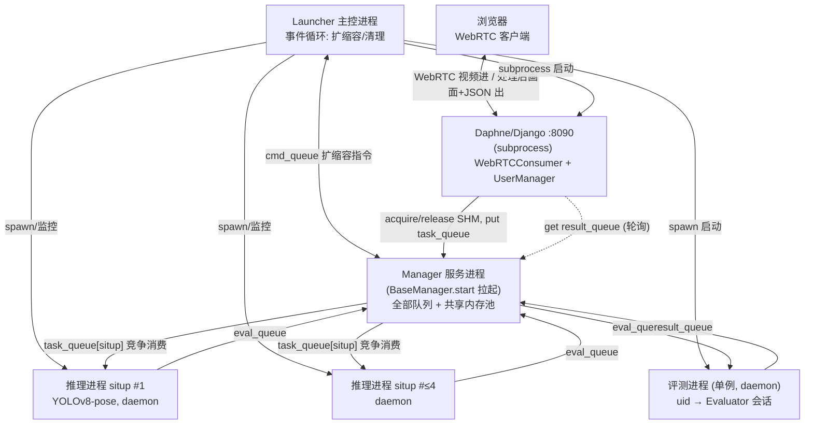
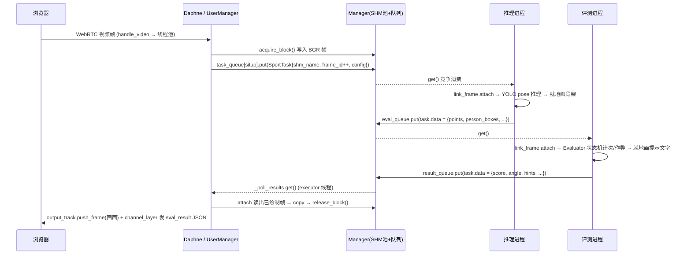

# 仰卧起坐后端多进程架构分析

> **状态：本描述的架构已决定被重构替换**——终态设计与落地步骤见 [refactor_plan.md](refactor_plan.md)，关键决策见 [adr/0001](adr/0001-web-spawns-user-processes.md)、[adr/0002](adr/0002-guarded-daphne-entry.md)。本文保留为旧架构的现状记录，§6 的薄弱点由该改造消除。
> 范围：`src/launcher.py`、`src/inference_worker.py`、`src/evaluation_worker.py`、`src/sport_situp.py`、`src/task.py`、`src/queue_manager.py`、`src/shared_memory_pool.py`，以及 `src/web_server/api/websocket.py`、`src/web_server/api/user_manager.py`。
> 旧版 `new_situp.py` / `new_pullup.py` 等不在范围内。本文只做现状描述，为后续改造做准备。

## 1. 进程拓扑

入口：`main.py` → `src.Launcher`（`mp.set_start_method('spawn', force=True)`）。

| 进程 | 启动方式 | 职责 | 生命周期 |
|---|---|---|---|
| Launcher 主控 | `main.py` 直接运行 | 创建 Manager/队列/SHM 池；拉起 Django 与评测进程；按用户数弹性增删推理进程 | 主事件循环，退出时统一清理 |
| Manager 服务 | `QueueManager.start()`（BaseManager） | 托管全部 `mp.Queue` 与 `SharedMemoryPool`；对外只暴露代理（proxy），调用经 localhost socket + pickle RPC | 与 Launcher 同生共死 |
| Daphne/Django | `subprocess.Popen`（cwd=`src/web_server`，env 传 `MANAGER_HOST/PORT/AUTH_KEY`） | WebRTC 收发、HTTP 开始/结束测试、`UserManager` 作为 IPC 客户端 | 独立 OS 进程 |
| 推理进程 | `mp.Process(daemon)`，按需 spawn | 消费 `task_queue[situp]`，每进程独立加载一个 YOLO 权重 | 空闲 60s 自毁（`IDLE_TIMEOUT`） |
| 评测进程 | `mp.Process(daemon)`，启动即建 | 单例消费 `eval_queue`（全部项目），维护 uid→Evaluator 会话，回写 `result_queue` | 常驻，**无监控/自动重启** |

扩容参数（`src/config.py`）：`USERS_PER_PROCESS=1`、`MAX_PROCESSES_PER_PROJECT=4`、`IDLE_TIMEOUT=60`。

## 2. IPC 机制

### 2.1 队列（全部托管在 Manager 进程）

`src/queue_manager.py` 用 `BaseManager.register` 注册 5 个工厂；调用方拿到的都是代理对象，**每次 `put/get/acquire` 都是一次 socket RPC + pickle 序列化**。

| 队列/资源 | 生产者 | 消费者 | 内容 |
|---|---|---|---|
| `task_queue[situp]` | `UserManager.push_frame` | situp 推理进程（多进程竞争） | `pickle(SportTask)`：uid/frame_id/shm_name/frame_shape/config，**不含帧数据** |
| `eval_queue` | 推理进程（含 finished 任务转发） | 评测进程 | SportTask + 推理结果 `data`（points 等） |
| `result_queue` | 评测进程 | `UserManager._poll_results` | SportTask + 评测结果 `data`（score/hints 等） |
| `cmd_queue` | `start/stop_sport_test` | Launcher 事件循环 | `('register'/'unregister', sport, ±1)` |
| SHM 池 | web 端 acquire/写入 | 推理/评测 attach 读+就地绘制，web attach 读+release | BGR 帧本体 |

### 2.2 共享内存池（`src/shared_memory_pool.py`）

- 预分配 `SHM_POOL_SIZE=30` 块，每块 `MAX_FRAME_BYTES = 720×1280×3 = 2,764,800 B`（按所有项目最大帧 jump 尺寸统一开）；situp 的 480×640 帧只占块前 921,600 字节，实际形状由 Task 携带。
- 池对象活在 Manager 进程：`acquire_block`/`release_block` 经代理执行，**锁与占用状态集中在 Manager 进程**。
- 池满时 `acquire(timeout=0.05)` 返回 `None` → web 直接**丢帧**（背压）。
- 泄漏兜底：`_reclaim_expired` 在每次 acquire 时惰性触发，占用超 `SHM_RECLAIM_TIMEOUT=10s` 的块被强制清零回收。
- 各进程 attach 用 `SharedMemoryPool.attach(shm_name, shape)` 直连共享内存（非代理调用），零拷贝读写。

### 2.3 SportTask 双份定义

`sport-backend/src/task.py` 与 `web_server/api/task.py` **内容完全相同**（刻意分离：Web 服务端不 import `src` 包），只能靠 `to_bytes()/from_bytes()`（pickle 一个 dict）跨边界。改动 Task 结构必须同步两份，否则 pickle 字典键不兼容。

同样注意：`web_server/api/shared_memory_pool.py` 是只保留 `attach` 的桩类；`web_server/api/config.py` 只有日志配置，与 `src/config.py` 不共享。

## 3. 一帧的完整数据流（situp）

要点：

1. **帧本体只走 SHM，队列里只有 640×480 大小以外的元数据**；但每帧仍有 2 次 Manager socket 往返（入队 + 结果出队）+ pickle。
2. **推理与评测都在共享内存帧上就地绘制**（骨架、关键点、提示文字），web 端读出的帧就是最终回传画面。
3. 输出轨 `ProcessVideoTrack` 只保留**最新一帧**（覆盖式，无队列），aiortc 按固定时钟编码回前端；评测 JSON 走 `InMemoryChannelLayer`（单 daphne 进程内）。
4. 配置流：前端 WS `config` 消息 → `user_manager.update_config` 写入 session，随**每帧 Task 的 config** 传给 Evaluator（如 `drawing`、`start` 计次开关）。

## 4. 会话与进程伸缩生命周期

**开始**：HTTP `GET api/situp/start/?uid=` → `UserManager.start_sport_test`：建 session（`frame_id=0`、空 config）、取 `task_queue[situp]` 代理、`cmd_queue.put(('register','situp',+1))`。

**扩缩容**（Launcher 事件循环，1s 轮询）：
`target = ceil(users / 1)`，上限 4，有用户时至少 1。
- 只**增**进程：`_adjust_processes` 仅在 `current < target` 时 spawn。
- 从不主动杀进程：`unregister` 只减计数，进程靠空闲 60s 自毁，Launcher 仅清理死进程引用（prune）。
- 推理进程死亡后若用户仍在线，下一轮 tick 会重新补齐。

**结束**：HTTP `api/situp/stop/` → session 弹出，向 `task_queue` 投 `finished=True, frame_id=-1, shm_name=None` 的 Task，再发 `('unregister',-1)`。
finished 任务经**推理进程原样转发**到 `eval_queue` → 评测进程删除 `user_sessions[uid]` 并回投 `result_queue` → web 收到 `stop` → 通知前端 `test_end` 并关闭 WS。
stop 之后仍残留在推理队列里的帧，由评测进程"uid 不在会话中 → data=None 丢弃"兜底。

## 5. situp 专属分工（`src/sport_situp.py`）

| 类 | 所在进程 | 频率 | 职责 |
|---|---|---|---|
| `Inferencer` | 每个推理进程各一份（spawn 后独立加载 YOLO 权重） | 每帧 | YOLOv8-pose 推理；按"靠画面中心+框面积"加权选人；可选绿色圆形标志物替换左髋；就地绘制骨架/框/关键点；返回 `{has_person, points[17], person_boxes, selected_idx}` |
| `Evaluator` | 评测进程内，按 uid 存于 `user_sessions` 字典 | 每帧 | 状态机 `WAITING→READY→FLAT↔RISE→FINISHED`；角度计算、计次（`score`）、6 类作弊检测；环境/提示文字绘制；返回 `{frame_id, score, angle, hints, 各作弊标志, ...}` |

**进程间契约**：Inferencer 的返回 dict 作为 `task.data` 直接被 Evaluator 消费（key：`points/has_person/person_boxes/selected_idx`），没有显式 schema，靠两个类同文件约定。

**乱序保护**：推理进程 ≥2 时同一用户的帧可能乱序到达评测进程；`Evaluator.process` 用 `if self.frame_id >= frame_id: return None` 丢弃旧帧。会话创建条件是 `frame_id == 0` —— 若 0 号帧丢失（推理进程中途崩溃），该用户**所有后续帧都会被当残留帧丢弃**，直到 stop。

## 6. 改造时需要关注的薄弱点

1. **无序/丢帧**：N 个推理进程竞争一个 `task_queue[situp]`，帧不保序，Evaluator 只能丢旧帧；`frame_id==0` 丢失会使整个会话作废（见 §5）。多用户时 4 进程上限内同一用户帧还可能分散到不同进程。
2. **Manager 单点 + RPC 开销**：所有队列调用都序列化经 Manager 进程 socket 转发；帧虽然走 SHM，但每帧仍 2 次 pickle RPC。Manager 进程挂掉 = 全系统失效。
3. **评测进程单点**：单例、无健康监控、无自动重启；`user_sessions` 只在 stop/finished 时删除，异常终止的测试会话会常驻。
4. **finished 结果重复投递**：`evaluation_worker.py` 中 `task.is_finished()` 分支 put 一次后**没有 `continue`**，末尾会再 put 一次同一 finished 任务（第二次到达时 web 端 consumer 已被移除，故表现无害但属浪费，改造时应确认）。
5. **SHM 生命周期靠超时兜底**：正常 release 只发生在 web 读结果时；推理/评测进程崩溃不会 release，靠 10s 惰性回收。
6. **只增不减的弹性**：`unregister` 不缩容，收敛依赖 60s 空闲自毁，短时高峰后进程数回落慢。
7. **冗余/失同步风险**：`task.py` 双份拷贝需手工同步；两个 worker 收到的 `shm_pool` 参数实际未使用（都用 `task.link_frame()` attach）。
8. **端口默认值不一致**：`src/config.py` 的 `MANAGER_PORT=50000`，web 端 fallback 默认 5000 —— 目前靠 launcher 注入 env 掩盖。
